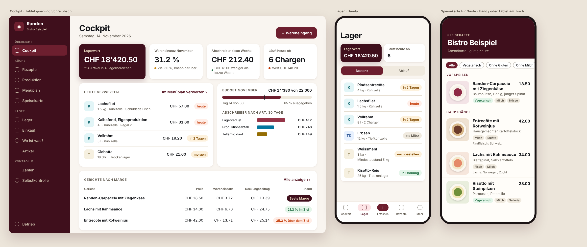

# Randen

Die Küche im Griff: Lager mit Ablaufdaten, «Wo ist was?» mit Fotos, Rezepte mit Kalkulation und Marge, Produktion, Menüplan, Speisekarte mit Allergenen, Einkauf, Zahlen und Selbstkontrolle. Für Betriebe vom Imbiss bis zur Grossküche. Local-first: Alles läuft auf dem Gerät, ohne Konto und ohne Server. Randen ist eine installierbare Web-App für iPhone, iPad und den Computer ([ADR-0013](docs/adr/0013-iphone-ipad-web.md)).

Randen ist die Schwester von [Rettich](https://github.com/BanioX/FridgeAI) (Haushalte) und übernimmt dessen Architektur. Beide sollen als getrennte Apps einer Firma auftreten (Entwurf [ADR-0020](docs/adr/0020-suite-der-firma.md)). Product Owner: Alban Hyseni. Dieses Repo ist privat.



## Stand

Was gebaut ist und was entsteht: [`docs/plan.md`](docs/plan.md). Bekannte, noch nicht behobene Fehler: [`docs/fehler.md`](docs/fehler.md).

## Schnellstart

```
corepack enable
pnpm install
pnpm dev            # App unter http://localhost:5173
pnpm check          # Lizenzen, Format, Lint, Typen, Kontrast, Tests, Build
```

## Aufbau

| Ort | Inhalt |
| --- | --- |
| `packages/core` | Die Logik, reines TypeScript: Modell, Rechenregeln (Einheiten, Ablauf, FEFO, Kalkulation, Deklaration, Break-even), Lager-Ledger, Schnittstelle, Module |
| `apps/web` | Die App: React, Tailwind, IndexedDB; UI-Kit, Seiten pro Bereich |
| `docs` | Plan, Entscheide (`adr/`, Index in [`adr/README.md`](docs/adr/README.md)), Design und UI-Kit, Regeln, Fakten mit Quellen, Glossar, Schulden, Nebenwirkungen, bekannte Fehler, Lernbuch, Vorschau-Links |

Karte für alle, die am Code arbeiten: [`AGENTS.md`](AGENTS.md). Regeln: [`CLAUDE.md`](CLAUDE.md).

## Grundsätze

- **Geld ist eine Ganzzahl**, Stückpreise sind Rappen pro 1000 Basiseinheiten ([ADR-0004](docs/adr/0004-money-units-and-prices.md)).
- **Bestand ändert nur das Lager-Ledger**; Kennzahlen lesen die Bewegungen ([ADR-0007](docs/adr/0007-stock-ledger.md)).
- **Allergene, Herkunft, Wareneinsatz und Marge werden berechnet**, nie gespeichert ([ADR-0008](docs/adr/0008-computed-not-stored.md)).
- **Nichts verlässt das Gerät** ([ADR-0006](docs/adr/0006-data-stays-on-the-device.md)).
- **Rechtliche Angaben nur mit Quelle** ([`docs/fakten.md`](docs/fakten.md), [ADR-0012](docs/adr/0012-facts-with-sources.md)).
- **Jede Küche wählt ihre Komplexität.** Die Betriebsart und die Antworten beim Einrichten schlagen die Funktionen vor; jede Funktion lässt sich einzeln schalten ([ADR-0015](docs/adr/0015-betriebsarten-und-funktionen.md)).

## Lizenz

Proprietär, alle Rechte bei Alban Hyseni ([`LICENSE`](LICENSE)). Abhängigkeiten behalten ihre eigenen Lizenzen; im ausgelieferten Code nur permissive (`pnpm licenses:check`).
